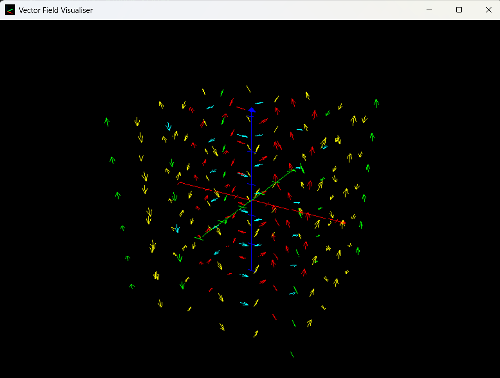

# Vector Field Visualiser

A DirectX application that lets you visualise a vector field (defined within the code).

## Running the program

This works on Windows only, as it uses DirectX. It can be run inside Visual Studio, or by running the following commands (you must have the Visual Studio Developer Command prompt installed):

- `devenv VectorFieldVisualiser.sln /build` to build
- `devenv VectorFieldVisualiser.sln /run` to run

## Example output

### Note on `shader_compiler.bat`

This is a bat file to generate shader cso files, and when run will request the following:

1. Shader file name (without the extension): The name of the shader file to be compiled (within the `Shaders` directory)
2. Shader entry point: The function to be compiled
3. Compiled name (without the extension): The name of the `.cso` file the shader will be compiled to. This will be
   in the `Shaders/Compiled` directory 